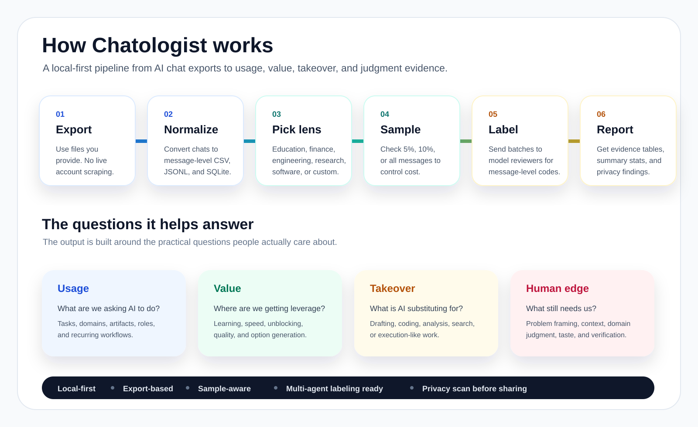

# Chatologist


**Figure out what you, your company, or your family are actually using AI for.**

Chatologist turns exported AI chat histories into structured evidence about usage, value, automation, and human judgment. It helps answer the practical questions that are surprisingly hard to see from memory alone:

- What do we keep asking AI to do?
- What value are we getting from it?
- What is AI really taking over?
- Where does human judgment, context, verification, and taste still matter?
- How does usage differ across engineering, education, finance, research, software, or a custom domain?

It is local-first, export-based, and designed for Codex and Claude Code workflows. No account scraping, no hidden data collection.



## Why This Exists

Most people have thousands of conversations with AI systems, but almost no structured view of what those conversations mean. Chatologist treats those chats as a private activity log that can be audited carefully.

Use it to build a map of:

- **Usage:** the tasks, domains, and recurring workflows where AI shows up.
- **Value:** where AI saves time, teaches, unblocks, improves quality, or helps decide.
- **Takeover:** where AI is substituting for work that used to require direct human execution.
- **Human edge:** where problem framing, context selection, domain judgment, and verification remain the scarce resource.
- **Risk:** where correctness, privacy, security, academic integrity, or professional judgment need review.

## Who It Is For

- **Individuals:** understand what your AI habit is becoming.
- **Families:** see how AI is being used for school, work, planning, learning, and everyday questions.
- **Companies:** audit how teams are deriving value from AI and where governance or training should focus.
- **Researchers:** turn chat exports into labeled evidence tables for descriptive studies.
- **Builders:** adapt the domain packs and labeling schema for new industries.

## What It Produces

- normalized message-level data: CSV, JSONL, and SQLite;
- AI/model-selected domain pack;
- sampled multi-agent labeling batches;
- reviewer instructions;
- validation report;
- domain report;
- coded message CSV;
- anonymized evidence table;
- privacy scan.

## Built-In Domain Packs

- `engineering`
- `education`
- `finance`
- `research`
- `software`
- `general-work`

The active AI model can also create a custom pack by editing `references/domain_packs.json`.

## Install For Codex

Use the repository root as a skill folder, or copy it into your Codex skills directory:

```bash
cp -R chatologist ~/.codex/skills/chatologist
```

Then restart Codex and invoke it as:

```text
$chatologist
```

## Install For Claude Code

This repo includes:

```text
.claude/skills/chatologist/SKILL.md
```

Use it as a project skill by keeping `.claude/skills/chatologist` in the repo. The wrapper expects the scripts and references to remain in the repository root.

## 5 Minute Smoke Test

```bash
python3 scripts/run_pipeline.py \
  --input examples/sample_openai_export/conversations.json \
  --output-dir tmp/sample_education \
  --audit-request "Audit education and student learning use" \
  --domain auto \
  --sample-percent 100 \
  --baseline-label
```

Expected outputs:

- `tmp/sample_education/setup/domain_selection.json`
- `tmp/sample_education/setup/labeling_instructions.md`
- `tmp/sample_education/report/domain_report.md`
- `tmp/sample_education/evidence/evidence_table.md`

`--baseline-label` is only for smoke tests. It proves the pipeline runs, but it is not research-grade labeling.

## Real Audit

Start with a small sample to control cost:

```bash
python3 scripts/run_pipeline.py \
  --input /path/to/openai-or-claude-export.zip \
  --output-dir audit_output \
  --audit-request "Figure out what my company is using AI for, what value we get, and what work AI is taking over" \
  --domain auto \
  --sample-percent 10
```

This creates sampled batches:

```text
audit_output/setup/batches/*.jsonl
audit_output/setup/labeling_instructions.md
```

For higher-quality results, send those batch files and the instructions to one or more model/agent reviewers. Save returned JSONL labels in:

```text
audit_output/labels/
```

Then validate and aggregate:

```bash
python3 scripts/validate_labels.py \
  --labels audit_output/labels \
  --domain education \
  --output audit_output/report/label_validation.json

python3 scripts/aggregate_results.py \
  --labels audit_output/labels \
  --domain education \
  --output-dir audit_output/report

python3 scripts/export_evidence_table.py \
  --labels audit_output/labels \
  --output-dir audit_output/evidence

python3 scripts/privacy_scan.py \
  --path audit_output/evidence \
  --output-dir audit_output/privacy
```

Use the selected domain from `audit_output/setup/domain_selection.json` when running the validation and aggregation commands.

## Output Layout

```text
audit_output/
├── normalized/
│   ├── messages.csv
│   ├── messages.jsonl
│   └── messages.sqlite3
├── setup/
│   ├── domain_selection.json
│   ├── labeling_instructions.md
│   ├── batch_manifest.json
│   └── batches/
├── labels/
├── report/
├── evidence/
└── privacy/
```

## Important Rules

- Use only exports the user provides.
- Do not scrape live accounts.
- Report the sample percentage.
- Keep out-of-scope messages visible in audit files but outside domain conclusions.
- Do not quote raw private messages in public reports.
- Treat findings as descriptive unless you have a real causal design.
- Run the privacy scan before sharing evidence tables or reports.

## Test

```bash
python3 -m unittest discover -s tests
```

## Friend Testing

See [FRIEND_TESTING.md](FRIEND_TESTING.md) for a short checklist to send to early testers.

## License

MIT.
