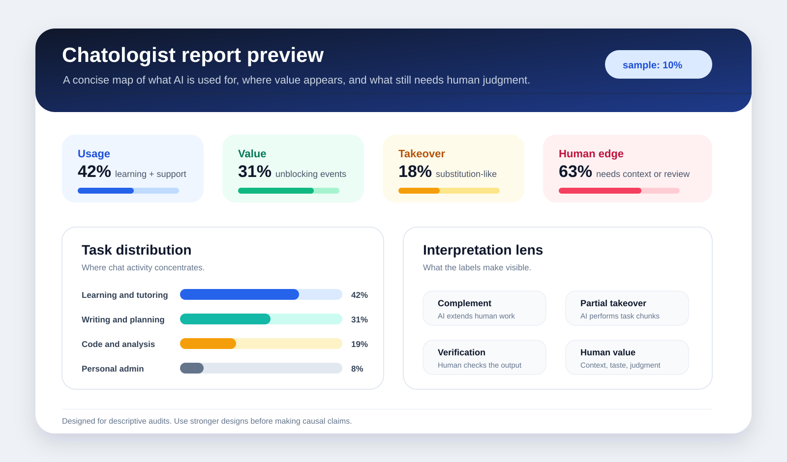

# Chatologist


**Figure out what you, your company, your class, or your family are actually using AI for.**

Chatologist turns exported AI chat histories into structured evidence about usage, value, automation, learning, verification, and human judgment. It helps answer the practical questions that are surprisingly hard to see from memory alone:

- What do we keep asking AI to do?
- What value are we getting from it?
- What is AI really taking over?
- Where does human judgment, context, verification, and taste still matter?
- What patterns appear when the labels are built for this specific person, team, or dataset?

It is local-first, export-based, and designed for Codex and Claude Code workflows. No account scraping, no hidden data collection.


## Why This Exists

Most people have thousands of conversations with AI systems, but almost no structured view of what those conversations mean. Chatologist treats those chats as a private activity log that can be audited carefully.

Use it to build a map of:

- **Usage:** the tasks, domains, and recurring workflows where AI shows up.
- **Value:** where AI saves time, teaches, unblocks, improves quality, or helps decide.
- **Takeover:** where AI is substituting for work that used to require direct human execution.
- **Human edge:** where problem framing, context selection, domain judgment, and verification remain the scarce resource.
- **Risk:** where correctness, privacy, security, academic integrity, or professional judgment need review.

## What Makes It Different

Chatologist does **not** ship fixed industry domain packs. Every audit creates its own **domain admin**: an editable codebook generated from the user's audit request plus a controlled sample of their normalized messages.

That means a student, a finance analyst, a founder, a teacher, or a research group each gets a codebook shaped around their own use case instead of being forced into generic categories.

The generated domain admin lives in:

```text
audit_output/setup/domain_admin.json
audit_output/setup/domain_admin_manifest.json
audit_output/setup/domain_admin.md
```

Review `domain_admin.md` and edit `domain_admin.json` before serious labeling. The generated draft is intentionally transparent, not magical.

## Who It Is For

- **Individuals:** understand what your AI habit is becoming.
- **Families:** see how AI is being used for school, work, planning, learning, and everyday questions.
- **Companies:** audit how teams are deriving value from AI and where governance or training should focus.
- **Researchers:** turn chat exports into labeled evidence tables for descriptive studies.
- **Builders:** adapt the generated domain admin and labeling schema for new contexts.

## What It Produces



- normalized message-level data: CSV, JSONL, and SQLite;
- generated user-specific domain admin;
- sampled multi-agent labeling batches;
- reviewer instructions;
- validation report;
- domain report;
- coded message CSV;
- anonymized evidence table;
- privacy scan.

## Install For Codex

Use the repository root as a skill folder, or copy it into your Codex skills directory:

```bash
cp -R chatologist ~/.codex/skills/chatologist
```

Then restart Codex and invoke it as:

```text
$chatologist
```

## Install For Claude Code

This repo includes:

```text
.claude/skills/chatologist/SKILL.md
```

Use it as a project skill by keeping `.claude/skills/chatologist` in the repo. The wrapper expects the scripts and references to remain in the repository root.

## Get Your Chat Export

Chatologist works from files you export yourself. It does not log into your account, scrape the sidebar, or read live chats.

### ChatGPT

Official guide: [Exporting your ChatGPT history and data](https://help.openai.com/en/articles/7260999-how-do-i-export-my-chatgpt-history-and-data).

1. Sign in to ChatGPT.
2. Open your profile menu.
3. Go to `Settings`.
4. Open `Data controls`.
5. Under `Export data`, select `Export`.
6. Confirm the export.
7. Wait for the email or SMS from OpenAI, then download the ZIP while signed in to the same account.

OpenAI says exports can take up to 7 days to arrive and the download link expires 24 hours after delivery. The ZIP includes chat history plus other relevant account data. Chatologist can read the ZIP directly:

```bash
python3 scripts/run_pipeline.py \
  --input /path/to/chatgpt-export.zip \
  --output-dir audit_output \
  --audit-request "Audit how I use AI for my work or studies" \
  --sample-percent 10
```

You can also unzip it and point Chatologist at the extracted folder or `conversations.json`.

### Claude

Official guide: [Export your Claude data](https://support.claude.com/en/articles/9450526-export-your-claude-data).

1. Open Claude on the web app or Claude Desktop.
2. Click your initials in the lower-left corner.
3. Select `Settings`.
4. Go to `Privacy`.
5. Click `Export data`.
6. Wait for the email from Claude, then download the export while signed in.

Claude notes that individual exports are available for Free, Pro, and Max users with active accounts. Team or Enterprise exports are handled by the organization's Primary Owner. Claude export links expire 24 hours after delivery.

Use the downloaded ZIP or extracted JSON folder as `--input`:

```bash
python3 scripts/run_pipeline.py \
  --input /path/to/claude-export.zip \
  --output-dir audit_output \
  --audit-request "Audit how I use AI for my work or studies" \
  --sample-percent 10
```

## 5 Minute Smoke Test

```bash
python3 scripts/run_pipeline.py \
  --input examples/sample_openai_export/conversations.json \
  --output-dir tmp/sample_student \
  --audit-request "Audit student learning and technical problem-solving with AI" \
  --sample-percent 100 \
  --baseline-label
```

Expected outputs:

- `tmp/sample_student/setup/domain_admin.json`
- `tmp/sample_student/setup/domain_admin.md`
- `tmp/sample_student/setup/domain_selection.json`
- `tmp/sample_student/setup/labeling_instructions.md`
- `tmp/sample_student/report/domain_report.md`
- `tmp/sample_student/evidence/evidence_table.md`

`--baseline-label` is only for smoke tests. It proves the pipeline runs, but it is not research-grade labeling.

## Real Audit

Start with a small sample to control cost:

```bash
python3 scripts/run_pipeline.py \
  --input /path/to/openai-or-claude-export.zip \
  --output-dir audit_output \
  --audit-request "Figure out what my company is using AI for, what value we get, and what work AI is taking over" \
  --sample-percent 10
```

This creates:

```text
audit_output/setup/domain_admin.json
audit_output/setup/domain_admin.md
audit_output/setup/batches/*.jsonl
audit_output/setup/labeling_instructions.md
```

Before full labeling, open `audit_output/setup/domain_admin.md`. If the labels are too generic, edit `audit_output/setup/domain_admin.json` and rerun batching.

For higher-quality results, send the batch files and the instructions to one or more model/agent reviewers. Save returned JSONL labels in:

```text
audit_output/labels/
```

Use the generated domain ID from `audit_output/setup/domain_selection.json` for validation and aggregation:

```bash
DOMAIN_ID=$(python3 - <<'PY'
import json
print(json.load(open("audit_output/setup/domain_selection.json"))["selected_domain_pack"])
PY
)

python3 scripts/validate_labels.py \
  --labels audit_output/labels \
  --domain "$DOMAIN_ID" \
  --domain-admin audit_output/setup/domain_admin.json \
  --output audit_output/report/label_validation.json

python3 scripts/aggregate_results.py \
  --labels audit_output/labels \
  --domain "$DOMAIN_ID" \
  --domain-admin audit_output/setup/domain_admin.json \
  --output-dir audit_output/report

python3 scripts/export_evidence_table.py \
  --labels audit_output/labels \
  --output-dir audit_output/evidence

python3 scripts/privacy_scan.py \
  --path audit_output/evidence \
  --output-dir audit_output/privacy
```

## Output Layout

```text
audit_output/
├── normalized/
│   ├── messages.csv
│   ├── messages.jsonl
│   └── messages.sqlite3
├── setup/
│   ├── domain_admin.json
│   ├── domain_admin_manifest.json
│   ├── domain_admin.md
│   ├── domain_selection.json
│   ├── labeling_instructions.md
│   ├── batch_manifest.json
│   └── batches/
├── labels/
├── report/
├── evidence/
└── privacy/
```

## Important Rules

- Use only exports the user provides.
- Do not scrape live accounts.
- Generate a domain admin for each user and dataset.
- Review the generated domain admin before serious labeling.
- Report the sample percentage.
- Keep out-of-scope messages visible in audit files but outside domain conclusions.
- Do not quote raw private messages in public reports.
- Treat findings as descriptive unless you have a real causal design.
- Run the privacy scan before sharing evidence tables or reports.

## References

- [Domain admin process](references/domain_admin_process.md)
- [Domain admin schema](references/domain_admin_schema.md)
- [Workflow](references/workflow.md)
- [Label schema](references/schema.md)
- [Multi-agent labeling](references/multi_agent_labeling.md)
- [Privacy rules](references/privacy.md)

## Test

```bash
python3 -m unittest discover -s tests
```

## Friend Testing

See [FRIEND_TESTING.md](FRIEND_TESTING.md) for a short checklist to send to early testers.

## License

MIT. In plain English: people can use, copy, modify, share, and commercially use Chatologist as long as they keep the license notice. The software is provided as-is, without warranty. See [LICENSE](LICENSE) for the full legal text.
